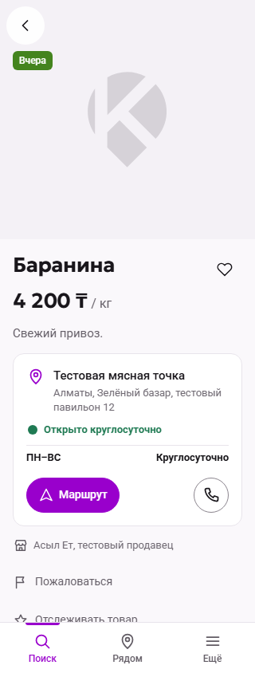
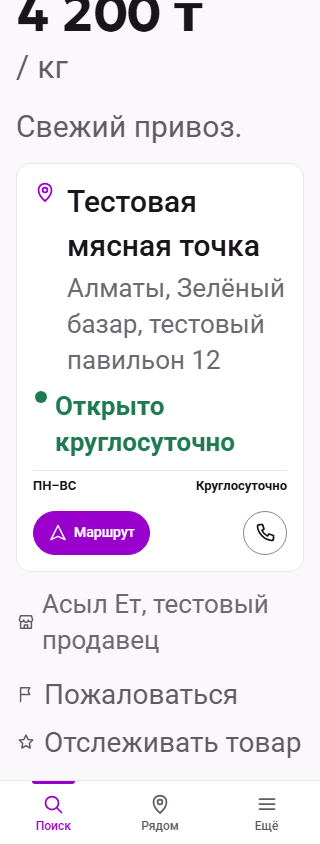
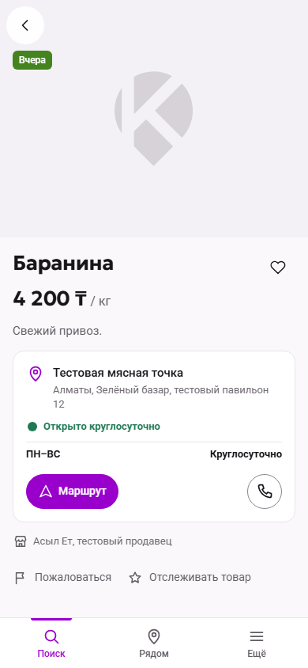
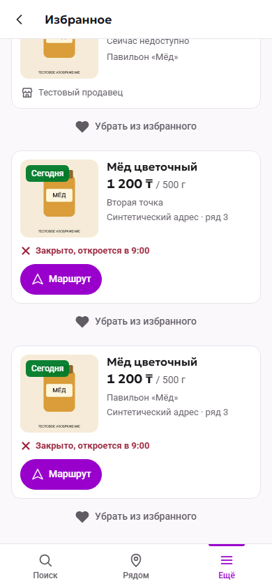
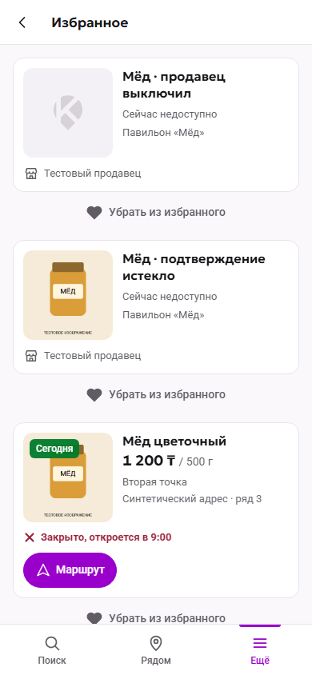
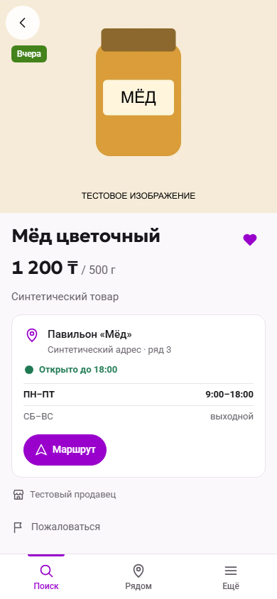

# Offer favourites — implementation acceptance

PO approval is recorded in the owning contract and the explicit S1/S5, actuality and offer-photos revisions. Docs PR [174](https://github.com/RashRosh/KAIDA.KZ-2.0/pull/174) is merged at `09768f80bec3fc4fc2e35c0e8d4ac8f4819fb80a`. Implementation remains on `slice/offer-favourites`; manual acceptance, implementation merge and checkpoint are separate gates.

The new heart and private list use current Offer data. An owner-only unavailable projection retains only title, public seller name and point name. Expired-active uses the current cover only through existing public media authorization; switched-off never returns a photo locator. Deleted/operator-removed entries are absent from both list and count. The additive `0028` table retains only the approved internal reference and cascades on account erasure. PO wording revision supersedes previous disable/notice/temporary-label instructions: Product button «Отслеживать товар» in both selected/unselected states, heart «Добавить в избранное»/«В избранном». Authentication/error/accessibility wording follows these labels. Existing S13 selection behavior/API/data remain intact; no tracking notifications are activated. Public Search, Nearby, detail and media predicates are unchanged.

## PO presentation amendment — 2026-10-13

Approved icon-only heart below the gallery beside title/price; borderless flag «Пожаловаться» and star «Отслеживать товар» row. Existing handlers, accessibility state/login, report focus return and privacy remain unchanged. At390px the two text actions share one row; at320px they wrap onto separate rows. Doubled text keeps targets at least44px, readable wrapping and no action-row horizontal overflow.

Local amended-head lint/types/production build PASS. Affected production-browser regressions:23 PASS/5 existing mobile-boundary skips, including new narrow/large-text targets, report return focus and guest-heart cancellation. Final amended-SHA full CI evidence belongs to PR175; earlier verification below describes the preceding implementation revision.

## Automated proof

Local lint, route types/TypeScript and production build pass. Full unit regression: 523 passing tests. Seven real PostgreSQL checks cover owner isolation, anonymous/override rejection, exact point identity, current prices, expiry boundary, inactive photo stripping, restoration, moderation/deletion/changed-point exclusion, retained-reference removal, concurrent idempotency, save-versus-moderation locking, and additive upgrade preservation of every pre-existing table including nonempty S13/photos.

Both new mobile browser flows pass against the production build: guest cancellation and automatic post-login save, independent points, safe return, current prices, unavailable transitions/media fallback, restoration, removal failure/retry, late old-account response rejection, existing Product selection preservation, preview suppression, direct-list login without auto-add, eligibility expiry during login and retryable list errors. Their runtime UUIDs are attached to the browser report before mutation. Required full final-SHA branch/PR verification and security checks must be green before the acceptance handoff; use the implementation PR checks for the authoritative SHA and full regression evidence.

## Isolated local acceptance

- App: <http://127.0.0.2:3300/favourites>. Controls: <http://127.0.0.2:3304/>. The controls are local test tooling, separate from product UI. Dedicated loopback host `127.0.0.2` isolates acceptance login cookies from the private snapshot on `127.0.0.1`/`localhost:3000`.
- Buyer: `+7 700 028 03 01`; use the test OTP shown by the existing login dialog. Seller fixture: `+7 700 028 03 02`. No real SMS.
- PostgreSQL container `kaida-favourites-pg`, ID `04a607f2911750ee8c2e2b350ce24d13b96fc73b388138300c04a1e577f2af32`, volume `kaida-favourites-pg`, loopback `55437`, acceptance database `kaida_favourites`, test database `kaida_test`.
- Complete local manifest, written before fixture mutations: root `tmp/favourites-acceptance-manifest.json`. UUID prefix `fb280000-0000-4000-8000-`: buyer `000000000001`, seller owner `000000000002`, seller `000000000003`, points `000000000004`/`000000000005`, card `000000000006`, Offers `000000000007`/`000000000008`, synthetic photo `000000000009`, expired `000000000010`, switched-off `000000000011`, operator-removed `000000000012`, deleted `000000000013`. Initial saved-entry suffixes `000000000100`–`000000000105`. Saved IDs created by later manual actions are ordinary generated UUIDs.
- Reset restores two available point-specific cards, one expired and one switched-off; deleted/operator-removed references remain hidden. Photo is a newly generated, explicitly labelled test illustration in the implementation worktree's isolated photo directory.
- Original development database/photos, personal files and port-3000 private snapshot are preserved. Read-only before/after receipts in root `tmp/favourites-preservation-*.json` compare complete table hashes, 3,296 original photo hashes, original container IDs and root Git index. Never upload private data or these internal receipts.

## Manual checklist

1. Open a fixture Offer signed out. Heart «Добавить в избранное» → cancel changes nothing; repeat and log in: the same Offer is saved once, labelled «В избранном». On the isolated seed lamb Offer `40000000-0000-4000-8000-000000000001` (Product `10000000-0000-4000-8000-000000000001`), «Отслеживать товар» stays enabled when idle, keeps the same label in both selection states, and preserves the existing selection/login/reload/removal behaviour. No «Скоро» or notice is added.
2. Open **More → Favourites**. Two points remain separate. Open a card and use Back to return to Favourites.
3. Use **Change first-point price** in controls, then refresh the list: current price becomes 1,750; no notification appears.
4. Use **Expire first-point confirmation**, then refresh: “Сейчас недоступно”, authorized current cover, no price or sales/detail actions. Removal remains usable.
5. Use **Switch first point off**, then refresh: neutral placeholder, no price/actions. Use **Restore the SAME first-point Offer**, refresh: normal presentation returns for that exact identity.
6. Remove an available or unavailable card. Use **Operator-remove the two-point card**, refresh: both entries disappear; deleted/operator-removed fixtures never show or count. Reset can restore the synthetic test setup.
7. Log out: private content disappears. A signed-out direct Favourites login loads the account's list without adding anything.

Acceptance scope: mobile Russian UI; Kazakh text remains provisional under the existing localization gate. STOP for PO acceptance of the exact final SHA. Do not merge the implementation or tag. Voice/translation remain paused; tracking, paid services and public launch are unauthorized.

## Implemented screenshots

